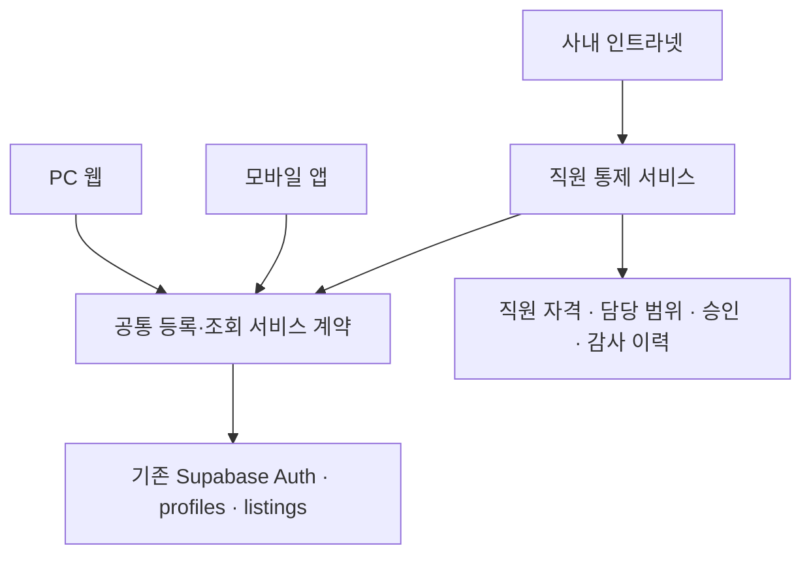

# 공통 데이터 기반 → 직원 통제 → 사내 인트라넷

변경 ID: SHARED-CORE-20261124. 대표 지시: 웹과 모바일의 등록 자료를 동일하게 유지하는 기반을 지금 갖추고, 이후 이를 통제할 별도 시스템과 사내 인트라넷으로 연결한다. PC 기준 원칙은 [통합 개발 오더](ORDER-web-mobile-unification-v1.md)를 따른다.

## 전체 구조와 원장

인트라넷이 있어야 웹·앱이 연결되는 것은 아니다. 웹·앱은 같은 Auth 계정과 listings UUID를 쓴다. 인트라넷도 이 ID를 참조한다. 앱에서 만든 매물을 웹용으로 복제하거나 인트라넷에 다시 등록하는 시스템을 만들지 않는다. 직원 배정·감사 등 운영 메타데이터는 별도로 둘 수 있으나 사용자·매물·문의 원장은 복제하지 않는다.

현재 구현은 UI → 공통 저장 계약 → 개발용 Supabase 직접 접근 어댑터다. 위 그림의 인증된 서버 쓰기와 직원 통제 서비스가 이미 배포됐다는 뜻이 아니다.

## 1단계: 등록 기반과 웹·앱 계약

PC 코드:

- `src/lib/listingPersistence.js`: 브라우저와 독립된 주입형 저장 어댑터. 허용 입력, 같은 생성 UUID 재시도, 저장 결과 확인, 명확한 실패를 공통 처리한다.
- `src/lib/listings.js`: 기존 클라이언트/기기 호환 연결. `saveListing({ payload, editingListingId, isDemo, creationId })` → `{ id, status, updated_at, omittedFields? }`.
- 신규는 같은 폼의 `creationId`를 유지하며 INSERT한다. 수정은 기존 ID의 UPDATE만 수행하고 소유자·상태를 payload로 바꾸지 않는다. `23505`는 같은 ID·입력·소유자·상태의 행을 읽어 확인할 때만 성공이다. UPSERT로 기존 행을 덮지 않는다.
- 동일 요청은 동의/사업자 확인 시각을 포함한 입력 snapshot을 유지한다. 실제 변경한 입력과 기존 ID가 충돌하면 명시적 실패 후 확인해야 한다. 네트워크 오류에 다른 ID로 자동 재등록하지 않는다.
- 저장은 반환 행의 ID와 상태를 확인해야 완료다. 0행·응답 누락·권한/네트워크 오류는 입력·초안을 유지한 채 실패한다. 정확하게 확인된 누락 좌표 열만 제한 호환하며 다른 입력/동의/지도 공개 여부를 조용히 버리지 않는다.
- `omittedFields`는 좌표 미저장 표시다. 저장 성공이 위치 정보까지 전부 보존됐다는 뜻으로 확대하지 않는다.
- PC 업체는 가짜 상호·사업자번호·검증 배지를 제거한다. 7분류와 세부 서비스, 입력한 정보만 business로 저장한다. 내 업체는 계정 기준 조회·같은 ID 수정으로 연결한다. 임의 인증·알림 발송·실적 검증 완료를 만들지 않는다.

### 모바일 Claude Code 적용 오더

모바일 기능 코드는 담당자가 기존 완성 기능을 보존해 반영한다. PC 직접 접근 방식이나 공개 SELECT *를 보안 기준으로 복사하지 않는다.

1. PC 위 두 파일의 공통 저장 계약을 검토하고 모바일의 `vendorListing`과 E1/E1p를 같은 반환·실패·UUID 계약에 맞춘다. 공통 순수 어댑터의 후속 단일 소스 배포 경로는 담당자와 확정하며, 무기록 사본을 각각 진화시키지 않는다.
2. `biz_category` 7키 consulting/interior/equipment/professional/finance/operations/marketing 및 `biz_services`의 카테고리별 목록을 유지한다. 업체의 `biz_founded`, `biz_solutions`, `biz_settings`는 이미 실제 DB에 존재한다. 사용자 입력 인증 여부를 직원 권한·검증된 소유권으로 신뢰하지 않는다.
3. `listings_visible`·quiet·사진/소개 숨김·명시 공개 투영 등 모바일의 더 엄격한 보호를 보존한다. 서버 공개 계약 전환 시 Realtime 원본 행 병합도 안전한 재조회로 바꾼다.
4. 수용 검사: PC 신규→앱 동일 ID 조회→앱 수정→PC 동일 ID 재조회. seller/landlord/business, lease/sale/both, 0/null, 사진 순서/삭제, 숨김·초안·공개·비공개 소개를 포함한다. 실패 전 성공 표시·이동 금지, 수정 중 INSERT 0회, 재시도 중복 0건을 검증한다.
5. 반영 커밋과 실제/모의 검사 결과를 회신한다. 문서 배치가 실행 중인 Claude의 읽음이나 앱 구현 완료를 뜻하지 않는다.

## 2단계: 서버 쓰기·공개 조회와 접근 통제 전환

[공유 접근 전환](shared-access-cutover.md)의 기존 앱 영향 검토/단일 SQL/대표 실행 절차를 따른다. PC가 별도 RLS 재잠금 SQL을 만들거나 실행하지 않는다.

- 한 공통 서버 경계에서 JWT를 검증하고 검증된 소유권으로 신규·수정·공개상태 변경을 처리한다. 브라우저 user_id/device_id/metadata를 허가로 쓰지 않는다.
- 공개 목록/상세와 본인 편집 응답을 분리한다. 숨김 상호·연락처·정확 위치·비공개 JSON은 공개 응답 전에 제외한다. `select('*')` 후 브라우저 숨김은 완료 조건이 아니다.
- 이전 개발 기간의 기존 행 귀속은 별도 검증한다. 과거 user_id가 있다는 이유로 자동 승인하지 않는다.
- 실제 anon/A/B/C와 위조 기기·역할 요청으로 본인 성공/타인 거부, 상태·공개 필드·재시도·실시간 재연결을 검사한다.

2026-11-24 읽기 점검: listings에는 `allow_all` ALL true 정책이 남아 있으며, `listings_visible`은 security_invoker 뷰다. 기존 개발 재개방 결정과 일치하지만 정식 보안 완료가 아니다. 이번 작업은 기존 데이터·RLS·grants를 바꾸지 않는다.

## 3단계: 직원 통제 시스템

회원의 6가지 이용 역할과 직원 자격을 분리한다. 같은 Auth UUID에 서버 관리 자격/활성 여부/권한/담당 범위를 연결하고 기본 거부한다. 브라우저 메뉴 숨김이나 사용자가 수정 가능한 프로필로 직원 자격을 주지 않는다.

첫 관리 흐름은 담당 매물·고객 배정, 공개/수정 요청 확인, 변경 이력이다. 읽기·수정 요청·승인·직원 권한 관리·내보내기 권한을 분리한다. 사용자 본인 수정에 모두 직원 승인을 강제하는 것은 확정된 요구가 아니다.

감사 항목은 행위자 UUID, 당시 권한/담당 범위, 대상 UUID, 작업/변경 항목/사유, 서버 시각, 요청 식별자, 성공·거부 결과다. 비밀번호·토큰·개인정보 전체 원문을 감사 이력에 복제하지 않는다. 소유권 이전·직원 권한 부여·연락처 공개/대량 내보내기는 요청자와 승인자 분리, 승인 후 상태 확인, 원자적 적용, 중복 실행 방지, 즉시 권한 회수가 필요하다.

스키마 제안 → 앱 영향 검토 → 대표 실행 → 서버 구현 → 실제 권한 검사의 순서를 완료한 뒤 직원 계정을 개방한다. 지금 직원 계정이나 작동하지 않는 관리 화면을 만들어 운영 가능한 것처럼 안내하지 않는다.

## 4단계: 사내 인트라넷과 프리미엄 운영

검증된 직원 통제 서비스 위에 직원 홈·업무 배정·고객 상담 이력·매물 진행·알림을 붙인다. 기존 사용자 문의 참가자 권한과 직원 업무 접근을 혼동하지 않는다. 외부 기업회원에 사내 고객 연락처를 넘기지 않는다.

대표가 저장한 프리미엄 방향도 이 단계에서 반영한다. 웹·앱의 직접 거래 프리미엄 매물 우선 공간을 마련하고, 직원의 고객 DB와 상담 맥락으로 적합한 매물을 가끔 추천하는 업무 흐름을 설계한다. 광고 게시와 다른 관계·추천·직접 거래 시스템을 상품의 근거로 삼되 아직 고객 DB 규모·자동 추천·알림 발송 기능이 있다고 주장하지 않는다. 동의·수신 거부·담당 범위를 구현한 뒤 발송하며 자연 검색 순위를 판매하지 않는다.

## 단계별 완료 상태

- 단일 Auth/매물 원장: 기존 운영 구조 사용.
- PC 저장 기반·업체 등록/수정: 이번 코드와 검사 결과를 work-status에 기록.
- 모바일 반영·양쪽 실제 등록 왕복: 담당자 구현/검증 대기. 문서 전달과 구분.
- 인증된 공통 서버·RLS 전환: 후속 단계. 기존 보안 절차 유지.
- 직원 통제·인트라넷: 설계 순서 확정, 미구현. 위 단계 완료 후 진행.

## 2026-11-24 후속: 서버 경계 코드 준비

SERVER-CORE-20261124에서 단일 API·서버 인증/입력/응답·공개 투영·웹/모바일 transport와 모의 HTTP 왕복을 구현했다. 상세 명령과 모바일 담당자의 DB 영향 검토 요청은 [공통 서버 계약](shared-listing-server-contract.md)을 따른다. 실제 승인 backend/DB 권한 전환·기존 화면의 서버 전환·모바일 실제 왕복·운영 배포는 별도다. 기본 API는503 CUTOVER_REQUIRED로 닫혀 있고 기존 개발 UI를 자동 전환하지 않는다.
